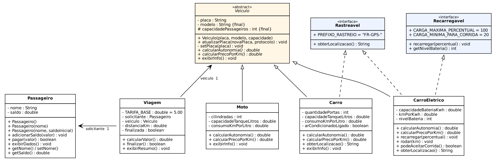
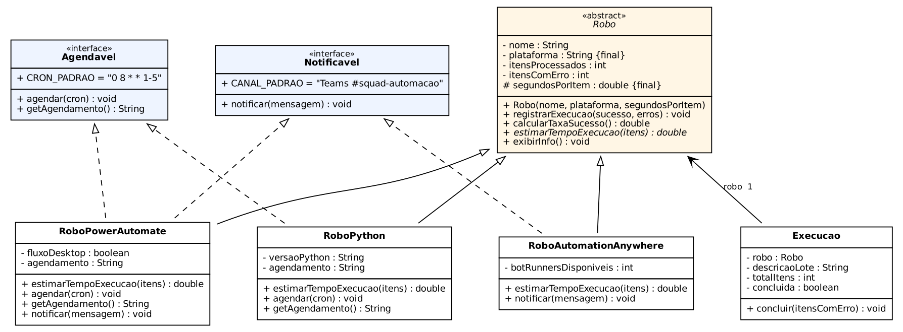

# Projeto FiapRide - Lucas [Sobrenome]

## 👤 Informações do Aluno

- **Nome:** Lucas [Sobrenome]
- **RM:** [Seu RM]
- **Turma:** [Sua Turma]
- **Curso:** [Seu Curso]
- **GitHub:** [@seu-usuario]

---

## 📖 Descrição do Projeto

Este projeto é o resultado do aprendizado nas aulas 1-9 de Programação Orientada a Objetos, onde desenvolvemos o sistema **FiapRide**, um app de mobilidade urbana. Nele, passageiros com carteira digital solicitam corridas, que são feitas por uma frota de carros a combustão, motos e carros elétricos.

O projeto evoluiu aula a aula (cada uma tem o seu commit). Começou como uma classe `Passageiro` com dois atributos públicos e terminou como uma hierarquia com classe abstrata, polimorfismo e interfaces. Junto com ele, desenvolvi o **desafio pessoal: Central de Robôs RPA**, ligado ao meu estágio em automação.

### Estrutura

```
src/br/com/
├── fiapride/
│   ├── Principal.java              ← main do FiapRide
│   └── model/
│       ├── Passageiro.java
│       ├── Veiculo.java            (abstract)
│       ├── Carro.java              extends Veiculo implements Rastreavel
│       ├── Moto.java               extends Veiculo
│       ├── CarroEletrico.java      extends Veiculo implements Recarregavel, Rastreavel
│       ├── Recarregavel.java       (interface)
│       ├── Rastreavel.java         (interface)
│       └── Viagem.java             TEM-UM Passageiro e TEM-UM Veiculo
└── rpa/                            ← desafio pessoal
    ├── PrincipalRpa.java
    └── model/
        ├── Robo.java               (abstract)
        ├── RoboPython.java         extends Robo implements Agendavel
        ├── RoboPowerAutomate.java  extends Robo implements Agendavel, Notificavel
        ├── RoboAutomationAnywhere.java extends Robo implements Notificavel
        ├── Agendavel.java          (interface)
        ├── Notificavel.java        (interface)
        └── Execucao.java           TEM-UM Robo
```

### Como executar

No Eclipse: rode `Principal.java` (FiapRide) ou `PrincipalRpa.java` (desafio pessoal). Precisa de Java 17 ou superior.

Pelo terminal:

```bash
javac -d bin $(find src -name "*.java")
java -cp bin br.com.fiapride.Principal
java -cp bin br.com.rpa.PrincipalRpa
```

### Diagramas de Classe

**FiapRide**



**Desafio pessoal: Central de Robôs RPA**



---

## ✅ Checklist de Implementação

- [x] Aula 1 - Classes e Objetos
- [x] Aula 2 - Métodos
- [x] Aula 3 - Encapsulamento
- [x] Aula 4 - Construtores
- [x] Aula 5 - Associação
- [x] Aula 6 - Herança
- [x] Aula 7 - Polimorfismo
- [x] Aula 8 - Classes Abstratas
- [x] Aula 9 - Interfaces

---

## 💭 Perguntas de Reflexão

### Aula 1 - Classes e Objetos

**Pergunta:** Por que precisamos criar uma classe `Passageiro`? Não seria mais fácil apenas criar variáveis soltas no main, como `String nomeAna = "Ana"` e `double saldoAna = 50.0`?

**Sua Resposta:**
Para dois ou três passageiros as variáveis soltas até funcionam. Com 1 milhão de usuários, porém, eu precisaria de 2 milhões de variáveis (`nomeAna`, `saldoAna`, `nomeBruno`, `saldoBruno`...) escritas à mão. Também não existiria nada no código garantindo que `saldoAna` pertence à Ana, e não ao Bruno. A classe é um **molde**: descrevo uma vez o que todo passageiro tem e crio quantos objetos eu quiser com `new Passageiro()`, inclusive dentro de um loop ou carregando de um banco de dados. Cada objeto carrega os próprios dados juntos, então a "Ana" é uma unidade só, e não duas variáveis que só por coincidência têm nomes parecidos. Quando o app precisar de um campo novo, como `email`, altero a classe em um lugar e todos os passageiros passam a ter esse campo. No meu estágio vejo a mesma ideia: um robô não processa "nota1, nota2, nota3"; ele processa uma lista de objetos `NotaFiscal` vindos do mesmo molde.

---

### Aula 2 - Métodos

**Pergunta:** Se nós podemos simplesmente fazer `passageiro.saldo = passageiro.saldo + 100` diretamente no código principal, por que dá tanto trabalho criar um método específico chamado `adicionarSaldo(valor)` para fazer isso? Quais seriam os riscos para a nossa startup de mobilidade se deixássemos qualquer programador alterar o saldo diretamente?

**Sua Resposta:**
O método coloca a **regra de negócio em um lugar só**. No meu `adicionarSaldo()`, um valor negativo ou zero é recusado. Se cada programador fizer `saldo = saldo + x` onde quiser, basta alguém esquecer a validação em uma tela para um `-500` virar dívida, ou para um bug de conversão creditar 10.000 em vez de 100. Os riscos para a startup são diretos: prejuízo financeiro, fraude (alguém "se dá" saldo), clientes cobrados errado e processos. Outro problema é que, com a regra espalhada em 50 lugares, uma mudança (por exemplo, "créditos acima de R$ 500 exigem verificação") obrigaria a caçar todas as ocorrências. Com o método, mudo em um lugar e tudo passa a respeitar a regra. O `pagar()` ainda devolve um `boolean`, então quem chama fica sabendo se o pagamento deu certo, em vez de o saldo simplesmente ficar negativo sem ninguém perceber.

---

### Aula 3 - Encapsulamento

**Pergunta:** No nosso código, os atributos são `private`, mas os métodos `getSaldo()` e `getNome()` são `public`. Por que é seguro deixar o `get` público, mas perigoso deixar o atributo original público?

**Sua Resposta:**
O `get` entrega uma **cópia do valor**. Quem chama `getSaldo()` recebe o número 50.0 e pode fazer o que quiser com ele, mas isso não muda o saldo real guardado dentro do objeto. É como entregar a cópia autenticada de um documento: a pessoa lê, confere e até rabisca a cópia, e o original continua intacto. Já um atributo `public` é entregar o **documento original** para qualquer parte do sistema rasurar, sem regra nenhuma. Por isso, no meu `Passageiro`, existe `getSaldo()`, mas não existe `setSaldo()`: o saldo só muda por `adicionarSaldo()` e `pagar()`, que validam a operação. Ler é seguro; escrever precisa passar por uma "portaria". Depois dessa aula, a linha `ana.saldo = 1_000_000;` passou a nem compilar, e é o compilador que protege o sistema por mim.

---

### Aula 4 - Construtores

**Pergunta:** Na nossa classe `Veiculo`, nós tomamos duas decisões arquitetônicas muito importantes: (1) Nós **não** criamos o método `setModelo()`. (2) O `setPlaca()` foi criado como **privado**, e criamos um método público chamado `atualizarPlaca()` para acessá-lo. Pensando no mundo real e no Clean Code: Por que é um erro gravíssimo clicar em "Gerar Getters e Setters para tudo" automaticamente na sua IDE? Como as nossas duas decisões acima protegem o sistema de fraudes e falhas de lógica?

**Sua Resposta:**
Gerar setters para tudo desfaz o encapsulamento: os atributos continuam `private` só no papel, porque qualquer um consegue mudá-los por um setter sem regra. Cada setter deve existir apenas se aquela mudança **acontece de verdade no mundo real**.
1. **Sem `setModelo()`:** um Onix nunca vira um Corolla. Se o sistema permitisse trocar o modelo, um motorista poderia cadastrar um carro popular e depois "transformá-lo" em sedã de luxo para cobrar a tarifa premium. Por isso o modelo é `final` e só entra pelo construtor.
2. **`setPlaca()` privado + `atualizarPlaca(novaPlaca, protocoloDetran)`:** placa muda, mas só por um **processo oficial** (como a conversão para o padrão Mercosul no Detran). Mudar um dado no banco é diferente de executar esse processo. Meu `atualizarPlaca()` exige o protocolo do Detran e registra a placa antiga e a nova; sem protocolo, a troca é recusada. Isso impede, por exemplo, que um motorista com multas troque a placa no app para fugir do histórico.

O construtor completa essa proteção: um `Veiculo` só nasce com placa válida e modelo, então nunca existe um objeto "pela metade". No `Passageiro`, usei `this(...)` para que os construtores padrão e de um parâmetro reaproveitem o construtor completo, sem duplicar validação.

---

### Aula 5 - Associação

**Pergunta:** No construtor da `Viagem`, nós exigimos o objeto inteiro (`Passageiro solicitante`). Se o nosso resumo só precisa imprimir o nome da pessoa, não seria mais fácil e mais leve pedir apenas a String do nome no construtor da Viagem (`String nomeDoPassageiro`) em vez do objeto todo?

**Sua Resposta:**
Seria mais leve, mas a Viagem ficaria **sem poder agir**. A String `"Ana Silva"` é só um texto: não tem saldo e não tem o método `pagar()`. Quando a corrida termina, meu `finalizar()` chama `solicitante.pagar(calcularValor())`, e isso só funciona porque a Viagem guarda uma **referência para o objeto real** da Ana. No `Principal`, depois de finalizar a viagem, o `ana.exibirDados()` mostra o saldo já descontado, ou seja, a Viagem mexeu na mesma Ana que existe no resto do sistema. Com uma String eu teria que procurar a passageira pelo nome em outro lugar, e se existissem duas "Ana Silva" o sistema poderia cobrar a pessoa errada. Quanto ao "peso", o Java não copia o objeto: a Viagem guarda só uma referência (um "endereço"), que custa praticamente o mesmo que guardar uma String. Associação (TEM-UM) é isto: um objeto **conhece** o outro para colaborar com ele.

---

### Aula 6 - Herança

**Pergunta:** No nosso código, a mãe `Veiculo` possui os atributos `placa` e `modelo` como `private`. Quando o `Carro` herda de `Veiculo`, ele recebe esses atributos, mas o código dentro de `Carro` NÃO consegue fazer `this.placa = "ABC"`. Ele é obrigado a usar o `super()` ou o `setPlaca()`. Por que o Java não deixa a filha alterar as variáveis privadas da mãe diretamente? Qual o princípio das aulas passadas que isso está protegendo?

**Sua Resposta:**
O princípio protegido é o **encapsulamento** (aula 3). `private` quer dizer "só esta classe mexe", e isso vale também para as filhas. Se o `Carro` pudesse fazer `this.placa = "ABC"`, ele pularia a validação de formato da placa que está no `Veiculo`, e toda filha nova (Moto, Van, Caminhão) seria uma nova chance de gravar placa inválida. Herdar não dá à filha o direito de quebrar as regras da mãe: a mãe continua sendo a "dona" dos próprios dados e a filha precisa pedir pelos meios oficiais. O `super(placa, modelo, 4)` faz justamente isso: a mãe inicializa a parte dela, com as validações dela, antes de a filha adicionar o que é seu. Quando eu quis que as filhas **lessem** algo diretamente, usei `protected final int capacidadePassageiros`: a Moto lê o valor para montar a mensagem, mas o `final` impede que alguém altere a lotação depois.

---

### Aula 7 - Polimorfismo

**Pergunta:** No nosso loop `for (Veiculo veiculo : frota)`, a variável `veiculo` é do tipo genérico `Veiculo`. Se esquecêssemos de criar o método `calcularAutonomia()` lá na classe mãe `Veiculo`, nós conseguiríamos chamá-lo dentro do loop, mesmo sabendo que ele existe dentro do `Carro` e da `Moto`? Por que o contrato precisa existir na base da hierarquia?

**Sua Resposta:**
Não conseguiríamos: daria **erro de compilação**. O compilador olha o **tipo da variável** (`Veiculo`), não o tipo real do objeto, e só permite chamar o que existe nesse tipo. Para o compilador, "um Veiculo qualquer" não garante ter `calcularAutonomia()`, porque amanhã alguém pode criar uma filha que não o tenha. Quando o método existe na mãe, ele vira um **contrato**: todo Veiculo, de qualquer tipo, sabe responder isso. Na execução, o Java escolhe qual versão rodar conforme o objeto real (Carro desconta 10% com o ar ligado, Moto não). A vantagem é que o loop da frota não precisa de `if (veiculo é Carro) ... else if (é Moto) ...`. Quando eu adicionei o `CarroEletrico` na aula 9, o loop funcionou sem mudar uma linha. No meu projeto RPA é igual: `estimarTempoExecucao()` está na mãe `Robo`, e cada plataforma calcula o tempo com o próprio overhead.

---

### Aula 8 - Classes Abstratas

**Pergunta:** Faz sentido existir um objeto que é APENAS "Veículo" sem ser um tipo específico? Por que, então, no código, precisamos EXPLICITAMENTE dizer ao Java que `Veiculo` é `abstract`? Por que ele não deduz isso sozinho? Se esquecermos de colocar `abstract`, qual o risco que corremos?

**Sua Resposta:**
No mundo real não faz sentido: ninguém sai da concessionária com "um veículo", sai com um carro ou uma moto. O Java, porém, não conhece o mundo real; ele só vê uma classe com atributos e construtor válidos, então para ele `new Veiculo(...)` é perfeitamente possível. Saber que o conceito é "genérico demais" é uma decisão de **modelagem de negócio**, não algo que o compilador consiga deduzir, por isso precisamos dizer explicitamente. Na minha versão da aula 7, `calcularAutonomia()` na mãe retornava `0`. Sem o `abstract`, alguém poderia criar um `Veiculo` genérico, colocá-lo na frota e o sistema calcularia autonomia 0 km e preço por km 0: uma corrida "de graça", ou um veículo que nunca seria escalado sem ninguém entender por quê. Com `abstract`, além de impedir o `new Veiculo()`, transformei `calcularAutonomia()` e `calcularPrecoPorKm()` em métodos abstratos. Agora toda filha é **obrigada** a implementá-los, senão nem compila, e o erro é pego na hora de programar, não em produção.

---

### Aula 9 - Interfaces

**Pergunta:** Por que Java permite herança simples (apenas uma mãe), mas múltipla implementação de interfaces (vários contratos)? Se `CarroEletrico` pudesse herdar de `Veiculo` E de `Bateria` ao mesmo tempo, o que aconteceria se AMBAS as mães tivessem um método chamado `ligar()`? Como as interfaces resolvem esse problema?

**Sua Resposta:**
É o **problema do diamante**. Se `Veiculo.ligar()` dá a partida no motor e `Bateria.ligar()` energiza as células, qual das duas implementações o `CarroEletrico` herdaria ao chamar `ligar()`? E se as duas mães tivessem um atributo `nivel` com significados diferentes? A ambiguidade não tem resposta certa, e o Java preferiu proibir em vez de adivinhar. Interfaces resolvem porque são **contratos sem implementação** (e sem estado, só constantes). Se duas interfaces declaram `ligar()`, não há conflito: as duas exigem a mesma coisa, e a **classe escreve uma única implementação** que satisfaz as duas. Na minha modelagem, o `CarroEletrico` **é um** `Veiculo` (extends) e **sabe fazer** duas coisas: ser `Recarregavel` e `Rastreavel` (implements). Interfaces descrevem capacidades que atravessam hierarquias: um patinete ou um celular também poderiam ser `Recarregavel` sem serem veículos. As constantes (`CARGA_MINIMA_PARA_CORRIDA = 20`) ficam no contrato, e o `Principal` usa essa regra para decidir se o carro precisa recarregar antes da próxima corrida. No RPA, o `RoboPowerAutomate` é `Agendavel` e `Notificavel` ao mesmo tempo, e a `Execucao` só envia o aviso no Teams para quem assinou o contrato `Notificavel`.

---

## 🚀 Desafios Técnicos Implementados

### Desafio Pessoal (Seu Projeto)

**Qual foi o domínio que você escolheu para seu projeto pessoal?**
**Central de Robôs RPA**: um sistema para gerenciar robôs de automação de processos, inspirado no meu estágio, onde trabalho com Python, Automation Anywhere e Power Automate.

**Quais classes você criou?**
- `Robo` (abstrata): nome, plataforma, indicadores de sucesso/erro e o método abstrato `estimarTempoExecucao()`
- `RoboPython`, `RoboPowerAutomate`, `RoboAutomationAnywhere`: filhas, cada uma com o próprio cálculo de tempo
- `Execucao`: um job sobre um lote de itens, associado a um `Robo` (TEM-UM)
- `Agendavel` e `Notificavel`: interfaces com as constantes `CRON_PADRAO` e `CANAL_PADRAO`

O projeto seguiu as mesmas 9 etapas do FiapRide, então cada commit evolui as duas partes.

**Qual foi o maior desafio técnico que você enfrentou?**
O maior desafio foi decidir **o que vira herança e o que vira interface**. No começo pensei em fazer `RoboAgendado` e `RoboNotificador` como classes filhas de `Robo`. Logo percebi o problema: o Power Automate é agendado **e** notifica, e Java não permite herdar das duas. Eu acabaria criando um `RoboAgendadoNotificador`, e as combinações iam se multiplicar. A solução foi separar **o que o robô é** (a ferramenta: Python, Power Automate, AA, que vira herança) do **que o robô sabe fazer** (agendar, notificar, que vira interface). Assim cada robô assina só os contratos que fazem sentido: o bot do AA é disparado pelo Control Room e por isso não é `Agendavel`, mas é `Notificavel`.

Outro ponto foi o `estimarTempoExecucao()`. Na primeira versão havia um cálculo genérico na mãe (`itens × segundosPorItem`), mas na prática cada ferramenta tem um overhead diferente: o Python ativa o ambiente virtual, o Power Automate Desktop abre uma sessão na máquina e o AA divide o lote entre os Bot Runners. Tornar o método abstrato obrigou cada filha a pensar no próprio caso, e o `segundosPorItem` ficou `protected final` para as filhas usarem sem poder alterar. Por fim, a `Execucao` usa `instanceof Notificavel` para avisar o time só quando o robô sabe notificar, o que me mostrou interfaces sendo usadas como tipo.

---

## 🎯 Conclusão

**O que você aprendeu nestas 9 aulas?**
Aprendi que orientação a objetos é mais sobre **proteger regras de negócio** do que sobre sintaxe. Cada aula fechou uma porta para um tipo de erro: a classe organiza os dados, o método centraliza a regra, o encapsulamento impede atalhos, o construtor impede objetos inválidos, a associação permite que objetos colaborem, a herança evita código repetido, o polimorfismo elimina os `if`s por tipo, a classe abstrata impede conceitos genéricos demais e a interface descreve capacidades sem amarrar hierarquias. Ver o mesmo projeto evoluir commit a commit deixou claro *por que* cada conceito existe, e não só *como* escrever. Também passei a enxergar esses conceitos nas ferramentas que uso no estágio.

**Qual conceito foi mais difícil de entender?**
Foi o polimorfismo, especificamente a diferença entre o **tipo da variável** e o **tipo do objeto**. Eu não entendia por que `Veiculo veiculo = new Carro(...)` não deixava chamar `getQuantidadePortas()`, mas chamava a versão do `Carro` de `calcularAutonomia()`. Superei a dificuldade separando os dois momentos: o compilador olha a variável para decidir **o que pode ser chamado**, e a JVM olha o objeto para decidir **qual versão roda**. Testar no loop da frota, imprimindo a autonomia de cada tipo, foi o que fez sentido para mim.

**O que você melhoraria no seu projeto se pudesse refazer?**
- `Carro` e `Moto` repetem `capacidadeTanqueLitros` e `consumoKmPorLitro`. Eu criaria uma classe intermediária `VeiculoCombustao` para concentrar isso.
- Uso `System.out.println` dentro das classes de modelo. O ideal seria o modelo só devolver resultados ou lançar exceções, deixando a exibição para outra camada.
- Algumas validações só imprimem uma mensagem e seguem. Eu padronizaria com exceções (`IllegalArgumentException`), como já fiz nos construtores.
- `agendar()` está duplicado em `RoboPython` e `RoboPowerAutomate`. Um método `default` na interface ou uma classe auxiliar resolveria.
- Valores em dinheiro usam `double`. Em um sistema real eu usaria `BigDecimal` para evitar erros de arredondamento.
- Eu adicionaria testes automatizados com JUnit em vez de validar tudo pelo `main`.
